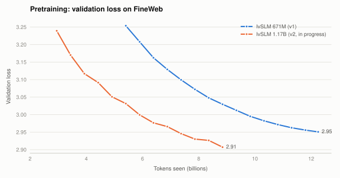

# IvSLM

**A small language model built from scratch, from pretraining to instruction tuning to math.**

IvSLM is a decoder-only transformer trained on [FineWeb](https://huggingface.co/datasets/HuggingFaceFW/fineweb).
It doesn't start from someone else's checkpoint: we pretrained the weights ourselves on ~12B tokens,
then fine-tuned the model to follow instructions and do arithmetic step by step.

The main model here is **IvSLM-671M**. A larger **1.17B** version with a newer architecture is in progress.

| | |
|---|---|
| 🧠 **Pretraining** | 671M parameters, 12.2B FineWeb tokens, final validation loss **2.95** |
| 💬 **Instruction tuning** | Before SFT the model answered *"What is the capital of France?"* with `_________`. After SFT it answers *"The capital of France is Paris."* |
| ➗ **Math** | Arithmetic accuracy went from **0% → 70%** on 200 unseen problems |
| 📚 **General knowledge** | Average across 13 standard benchmarks moved by only −1.3 points after all fine-tuning |

---

## Contents

- [Results](#results)
- [How it was trained](#how-it-was-trained)
- [Example outputs](#example-outputs)
- [Limitations](#limitations)
- [Reproduce it](#reproduce-it)
- [Repository layout](#repository-layout)
- [Model details](#model-details)

---

## Results

### Pretraining

<picture>
  <source media="(prefers-color-scheme: dark)" srcset="docs/assets/pretrain-val-loss-dark.svg">
  
</picture>

Validation loss on a held-out FineWeb shard (100M tokens). The 671M curve starts at 5.4B tokens
because that's where the logged run resumed. The **1.17B v2** model gets below the 671M model's
final loss after just 7.4B tokens (~40% fewer), so the extra capacity and architecture changes help.
Full training logs are on [Weights & Biases](https://forge.coreweave.com/wandb/ChinmayK0604/ivllm/runs/rd1e0t4e).

### Math

<picture>
  <source media="(prefers-color-scheme: dark)" srcset="docs/assets/math-accuracy-dark.svg">
  
</picture>

| Model | Arithmetic (200 unseen problems) | GSM8K (200 test problems) | Answer loss on held-out Alpaca ↓ |
|---|---:|---:|---:|
| Base (pretrained only) | 0.0% | 0.0% | 2.437 |
| + Alpaca SFT | 0.5% | 2.0% | 1.974 |
| + Math SFT v1 | 62.0% | 7.0% | 1.964 |
| **+ Math SFT v2** | **70.0%** | **7.0%** | **1.960** |

Scoring is exact match on the final number, with greedy decoding. The arithmetic test questions
come from a different random seed than the training data, and any overlap is removed, so the model
has never seen them.

**What changed between v1 and v2?** v1 worked through each column correctly but often wrote the
final digits in the wrong order. For example, it computed *hundreds 1, tens 9, ones 1* and then
answered **119**. In v2 every worked example ends by reading the digits back from the highest place
(*"hundreds 1, tens 9, ones 1, which gives 191"*). That one change took accuracy from 62% to 70%.

### General knowledge

<picture>
  <source media="(prefers-color-scheme: dark)" srcset="docs/assets/benchmarks-dark.svg">
  
</picture>

| Task | Base | Alpaca SFT | Math SFT v2 |
|---|---:|---:|---:|
| SciQ | 74.3 | 75.3 | 74.8 |
| COPA | 68.0 | 71.0 | 69.0 |
| PIQA | 68.3 | 66.9 | 67.3 |
| BoolQ | 61.4 | 57.8 | 51.1 |
| Winogrande | 50.3 | 51.5 | 50.4 |
| ARC-Easy | 49.1 | 45.5 | 45.6 |
| LAMBADA | 37.7 | 27.9 | 31.4 |
| HellaSwag | 32.4 | 33.3 | 33.0 |
| RACE | 30.0 | 30.4 | 29.7 |
| MMLU | 22.9 | 24.6 | 23.5 |
| ARC-Challenge | 19.8 | 21.9 | 21.6 |
| CommonsenseQA | 19.6 | 18.8 | 20.1 |
| OpenBookQA | 18.0 | 16.8 | 17.2 |
| **Average** | **42.4** | **41.7** | **41.1** |

These are 0-shot accuracies (%) from [lm-evaluation-harness](https://github.com/EleutherAI/lm-evaluation-harness).
Fine-tuning mostly kept what the model learned in pretraining. There are two exceptions:

- **LAMBADA** (predicting the last word of a passage) drops because an instruction-tuned model
  prefers to *answer* rather than continue raw text. This is a well-known side effect of SFT.
- **BoolQ** (yes/no reading comprehension) drops 10 points after math SFT. This is the real cost
  of the math data, and fixing it is on the to-do list.

### Fine-tuning curves

<picture>
  <source media="(prefers-color-scheme: dark)" srcset="docs/assets/sft-loss-dark.svg">
  
</picture>

The Alpaca run steps down at each new epoch (3 epochs in total). That pattern is a sign it was
starting to memorise, so the math runs use 2 epochs. The math runs reach lower loss because worked
arithmetic is much more predictable than open-ended answers.

---

## How it was trained

```
FineWeb (12.2B tokens) ──► Pretraining ──► Alpaca SFT ──► Math SFT
       8 GPUs, ~770k tok/s       IvSLM-671M      instruction       arithmetic +
                                  val loss 2.95   following         word problems
```

**1. Pretraining.** Next-token prediction on FineWeb (GPT-2 tokenizer, 2,048-token context),
12,459 steps with ~983k tokens per step, on 8 GPUs. AdamW, 2,000 warmup steps, then cosine decay
from 3e-4 to 3e-5.

**2. Instruction tuning (SFT).** 50k [Alpaca](https://huggingface.co/datasets/tatsu-lab/alpaca)
examples in a simple `Human: … Assistant: …` format. Loss is computed only on the answer tokens,
so the model learns to *respond* rather than to repeat prompts.

**3. Math SFT.** Starts again from the pretrained weights, with a mix of general and math data:

| Data | Examples | Purpose |
|---|---:|---|
| Alpaca | 30,000 | Keep general instruction following |
| [GSM8K](https://huggingface.co/datasets/openai/gsm8k) train | 7,473 | Grade-school word problems with worked solutions |
| [MetaMathQA](https://huggingface.co/datasets/meta-math/MetaMathQA) (GSM subsets) | 25,000 | More word problems, rephrased |
| Synthetic arithmetic | 20,000 | Digit-by-digit `+ − × ÷` with carries, borrows and a final read-back step |

Every math answer ends with *"The answer is N."* so results can be checked automatically.

Fine-tuning ran on a single **L40S** GPU on [Modal](https://modal.com). Each SFT run takes about an
hour and costs a few dollars.

---

## Example outputs

Greedy decoding, same prompts, before and after fine-tuning.

**"What is the capital of France?"**
- *Base:* `_________________`
- *Math SFT v2:* The capital of France is Paris.

**"Give three tips for staying healthy."**
- *Base:* `____-____-____-____-____-…`
- *Math SFT v2:*
  1. Eat a balanced diet, including plenty of fruits, vegetables, whole grains, and lean proteins.
  2. Exercise regularly to stay fit and healthy.
  3. Get enough sleep and practice good sleep hygiene.

**"Compute 1166 − 975."**
```
Ones: 6 - 5 = 1.
Tens: 6 is less than 7, so borrow 1: 16 - 7 = 9.
Hundreds: 1 - 1 (borrowed) is less than 9, so borrow 1: 11 - 1 (borrowed) - 9 = 1.
Thousands: 1 - 1 (borrowed) - 0 = 0.
Reading from the highest place: hundreds 1, tens 9, ones 1, which gives 191.
So 1166 - 975 = 191. The answer is 191.
```

---

## Limitations

This is a 671M model trained on 12B tokens, and it behaves like one.

- **Word problems are hard for it.** GSM8K is at 7%. The model often picks the wrong operation
  (it treats "gives 5 away" as an addition), and inside word problems it does sums in its head
  instead of using the column method.
- **It makes things up.** With this little pretraining, its factual knowledge is shallow.
- **Long answers can repeat.** Greedy decoding sometimes loops on a sentence.
- **Arithmetic isn't perfect.** 70% means it still gets nearly a third of the problems wrong.

---

## Reproduce it

Fine-tuning and evaluation run on [Modal](https://modal.com). The pretrained 671M weights are
downloaded from Hugging Face ([`Samarth0710/ivllm-671m-fineweb12b`](https://huggingface.co/Samarth0710/ivllm-671m-fineweb12b)).

```bash
pip install modal && modal setup

modal run modal_train.py::download_weights                    # fetch + verify the 671M weights
modal run modal_train.py::sft                                 # Alpaca SFT
modal run modal_train.py::sft_math --output-name ivllm_sft_math_v2.pt   # math SFT
modal run modal_train.py::compare                             # math accuracy + sample answers
modal run modal_train.py::benchmark                           # 13 lm-eval benchmarks
```

Checkpoints are saved to a persistent Modal volume (`ivllm-checkpoints`), so each step can be run
separately. Add `--detach` to keep a run going after you close the terminal.

**Pretraining from scratch** (multi-GPU, uses the v2 1.17B architecture in `ivllm.py`):

```bash
pip install -r requirements.txt
torchrun --standalone --nproc_per_node=8 ivllm.py
```

Training is configured through `IVLLM_*` environment variables (token budget, LR schedule,
data mix, batch size, inline eval). It saves a checkpoint every 500 steps and resumes
automatically from `checkpoints/ivllm_latest.pt`.

---

## Repository layout

| Path | What it is |
|---|---|
| `base_model.py` | IvSLM-671M model definition (GQA, SwiGLU, RoPE, RMSNorm) |
| `ivllm.py` | v2 1.17B model + multi-GPU pretraining loop (QK-Norm, value residual, head gating, WSD schedule) |
| `data.py` | Sharded, streaming data loader for pretraining |
| `sft.py`, `sft_data.py` | Supervised fine-tuning with answer-only loss |
| `math_data.py` | Math SFT mix, synthetic arithmetic generator, answer extraction and scoring |
| `modal_train.py` | Modal GPU jobs: download, SFT, math SFT, comparison, benchmarks |
| `download_base.py` | Download the pretrained weights from Hugging Face and convert them locally |
| `eval_ivllm.py` | lm-evaluation-harness wrapper (multiple-choice / log-likelihood tasks) |
| `generate.py` | Sampling utilities |
| `scripts/build_release.py` | Package a checkpoint as a Hugging Face release |
| `release/ivllm-671m-fineweb12b/` | Model card, config and standalone modeling code for the 671M release |
| `eval_v2_step2500*.json` | Full benchmark results for the **1.17B v2** model at step 2,500 |
| `agent.py`, `jepa.py`, `reward_model.py`, `grpo.py`, `train_pipeline.py` | Experimental, not covered by the results above |

> The code still uses the original working name `IvLLM` for classes and checkpoint files
> (`ivllm_*.pt`). It refers to the same model.

Checkpoints (`*.pt`, `*.safetensors`), datasets and `wandb/` logs are not tracked in git.

---

## Model details

| | IvSLM-671M (v1) | IvSLM-1.17B (v2, in progress) |
|---|---|---|
| Parameters | 671M | 1.17B |
| Layers | 24 | 24 |
| Hidden size | 1,536 | 2,048 |
| Attention | GQA, 24 query / 6 KV heads | GQA, 16 query / 4 KV heads, QK-Norm |
| Feed-forward | SwiGLU (4,096) | SwiGLU |
| Position encoding | RoPE (θ = 10,000) | RoPE |
| Context length | 2,048 | 2,048 |
| Tokenizer | GPT-2 (tiktoken), vocab 50,304 | same |
| Embeddings | Tied input/output | Tied |
| Pretraining data | FineWeb, 12.2B tokens | FineWeb + 6% math, 8.9B tokens so far |
| Final val loss | 2.95 | 2.91 (at 8.9B tokens) |
