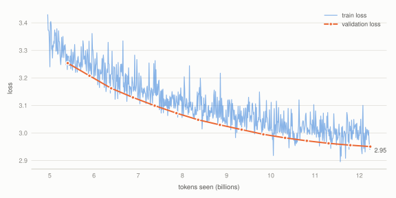
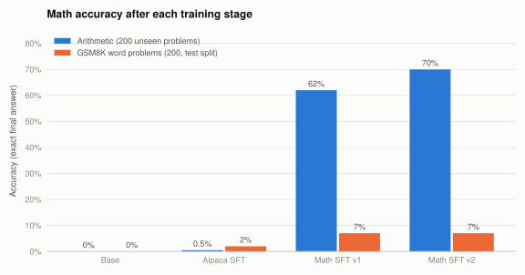
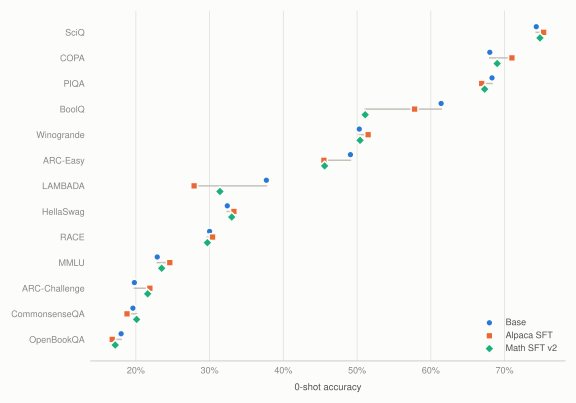
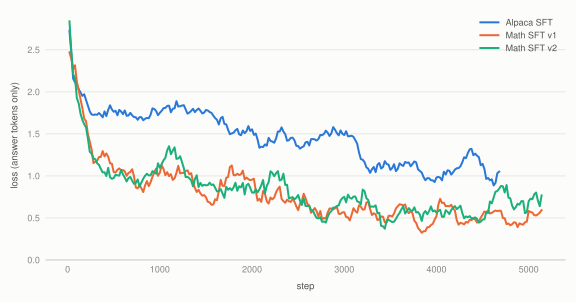

# IvSLM

IvSLM is a 671M parameter language model that we trained from scratch. No borrowed checkpoint:
the weights start random, get pretrained on about 12 billion tokens of web text, and are then
fine-tuned to follow instructions and do arithmetic step by step.

It's small, so don't expect it to write essays. The goal was to go through the whole pipeline
ourselves and measure what each stage actually changes.

Where it stands right now:

- Pretraining finished at a validation loss of 2.95 on FineWeb.
- After fine-tuning, it answers simple questions properly. Before, it just printed underscores.
- It gets 70% of unseen arithmetic problems right, up from 0%.
- It mostly kept its general knowledge through fine-tuning: the average across 13 standard
  benchmarks went from 42.4% to 41.1%.

## Pretraining

<picture>
  <source media="(prefers-color-scheme: dark)" srcset="docs/assets/pretrain-loss-dark.svg">
  
</picture>

We trained on [FineWeb](https://huggingface.co/datasets/HuggingFaceFW/fineweb) with the GPT-2
tokenizer, 2,048 tokens of context, and about a million tokens per step. Training ran for 12,459
steps on 8 GPUs, roughly 12.2B tokens in total. The plot starts at 5B tokens because that's where
the logged run picked up after a restart. The full logs are on
[W&B](https://forge.coreweave.com/wandb/ChinmayK0604/ivllm/runs/rd1e0t4e).

Validation loss was still dropping when we stopped, so more tokens would have helped.

## Teaching it to answer questions

A pretrained model only knows how to continue text. Ask it *"What is the capital of France?"*
and you get `_________________`, because that's what often follows a question on the internet
(think fill-in-the-blank worksheets).

So we fine-tuned it on 50k examples from [Alpaca](https://huggingface.co/datasets/tatsu-lab/alpaca),
in a plain `Human: ... Assistant: ...` format, with loss only on the answer tokens. Afterwards:

> **Q:** What is the capital of France?
> **A:** The capital of France is Paris.

> **Q:** Give three tips for staying healthy.
> **A:** 1. Eat a balanced diet that is rich in fruits, vegetables, and lean proteins.
> 2. Exercise regularly to stay fit and healthy. 3. Get enough sleep and avoid caffeine and alcohol.

It still couldn't do math, though. *"What is 15 + 27?"* got the answer *"15 + 27 is equivalent to
15 + 27 in currency terms."*

## Math

<picture>
  <source media="(prefers-color-scheme: dark)" srcset="docs/assets/math-accuracy-dark.svg">
  
</picture>

For math we went back to the pretrained weights and fine-tuned on a mix of:

- 30k Alpaca examples, so it doesn't forget how to answer normal questions
- 7.5k [GSM8K](https://huggingface.co/datasets/openai/gsm8k) word problems with worked solutions
- 25k word problems from [MetaMathQA](https://huggingface.co/datasets/meta-math/MetaMathQA)
- 20k generated arithmetic problems, solved column by column with carries and borrows

We also looked at Nemotron's math set, but it's mostly olympiad and university-level problems,
which are far beyond a model this size.

The first attempt (v1) reached 62% on arithmetic. When we read through its mistakes, a lot of them
looked like this one:

```
Compute 1166 - 975.
Ones: 6 - 5 = 1.
Tens: 6 is less than 7, so borrow 1: 16 - 7 = 9.
Hundreds: 1 - 1 (borrowed) is less than 9, so borrow 1: 11 - 1 (borrowed) - 9 = 1.
Thousands: 1 - 1 (borrowed) - 0 = 0.
So 1166 - 975 = 119. The answer is 119.
```

Every column is right (1, 9, 1), but the digits come out backwards.

The model did each column correctly and then wrote the digits in the wrong order. In v2 we added
one line to every worked example that reads the result back from the highest place:

```
Reading from the highest place: hundreds 1, tens 9, ones 1, which gives 191.
So 1166 - 975 = 191. The answer is 191.
```

That one line took arithmetic accuracy from 62% to 70%.

| | arithmetic | GSM8K | answer loss on held-out Alpaca |
|---|---:|---:|---:|
| base | 0% | 0% | 2.437 |
| + Alpaca SFT | 0.5% | 2% | 1.974 |
| + math SFT v1 | 62% | 7% | 1.964 |
| + math SFT v2 | **70%** | **7%** | **1.960** |

Each test has 200 problems, with greedy decoding and exact match on the final number. The
arithmetic test uses a different random seed from the training data, with duplicates removed, so
the model has never seen those exact problems.

GSM8K barely moved, and we expected that. Word problems need the model to understand what's going
on before it does any math, and that's where a 671M model struggles. Here's a typical mistake:

> **Q:** Tom has 12 apples. He gives 5 to his friend and buys 8 more. How many apples does he have now?
> **A:** He gives 5 to his friend, so he now has 12 + 5 = 17 apples. He then buys 8 more apples,
> so he now has 17 + 8 = 23 apples.

It gets the operation wrong ("gives away" turns into an addition), and then the addition itself is
wrong too.

## Did fine-tuning break anything?

<picture>
  <source media="(prefers-color-scheme: dark)" srcset="docs/assets/benchmarks-dark.svg">
  
</picture>

We ran 13 standard benchmarks with
[lm-evaluation-harness](https://github.com/EleutherAI/lm-evaluation-harness) (0-shot) on the base
model and on both fine-tuned versions.

| task | base | Alpaca SFT | math SFT v2 |
|---|---:|---:|---:|
| SciQ | 74.3 | 75.3 | 74.8 |
| COPA | 68.0 | 71.0 | 69.0 |
| PIQA | 68.3 | 66.9 | 67.3 |
| BoolQ | 61.4 | 57.8 | 51.1 |
| Winogrande | 50.3 | 51.5 | 50.4 |
| ARC-Easy | 49.1 | 45.5 | 45.6 |
| LAMBADA | 37.7 | 27.9 | 31.4 |
| HellaSwag | 32.4 | 33.3 | 33.0 |
| RACE | 30.0 | 30.4 | 29.7 |
| MMLU | 22.9 | 24.6 | 23.5 |
| ARC-Challenge | 19.8 | 21.9 | 21.6 |
| CommonsenseQA | 19.6 | 18.8 | 20.1 |
| OpenBookQA | 18.0 | 16.8 | 17.2 |
| average | 42.4 | 41.7 | 41.1 |

Mostly no. Most tasks moved by a point or two either way. Two did drop:

- **LAMBADA** asks the model to predict the last word of a passage. After instruction tuning it
  would rather answer than continue raw text, which is a common side effect.
- **BoolQ** (yes/no questions about a passage) fell 10 points after the math training. This is a
  real regression, and the next thing we want to fix.

<details>
<summary>Fine-tuning loss curves</summary>

<picture>
  <source media="(prefers-color-scheme: dark)" srcset="docs/assets/sft-loss-dark.svg">
  
</picture>

The Alpaca run drops sharply at the start of each epoch, a sign it was starting to memorise the
data by the third pass. That's why the math runs use two epochs instead of three. The math runs end
lower simply because worked arithmetic is much more predictable than open-ended answers.

</details>

## Running it yourself

Fine-tuning and evaluation run on [Modal](https://modal.com) with one L40S GPU. Each SFT run takes
about an hour and costs a few dollars. The pretrained weights are on Hugging Face at
[`Samarth0710/ivllm-671m-fineweb12b`](https://huggingface.co/Samarth0710/ivllm-671m-fineweb12b).

```bash
pip install modal
modal setup

modal run modal_train.py::download_weights        # get the pretrained weights
modal run modal_train.py::sft                     # Alpaca fine-tuning
modal run modal_train.py::sft_math --output-name ivllm_sft_math_v2.pt
modal run modal_train.py::compare                 # math accuracy + sample answers
modal run modal_train.py::benchmark               # the 13 benchmarks
```

Checkpoints live on a Modal volume, so you can run the steps one at a time. Add `--detach` if you
want to close your laptop while something trains.

## What's in here

| file | what it does |
|---|---|
| `base_model.py` | the 671M model |
| `sft.py`, `sft_data.py` | instruction fine-tuning |
| `math_data.py` | math training mix, the arithmetic generator, and answer checking |
| `modal_train.py` | all the GPU jobs (download, fine-tune, evaluate) |
| `eval_ivllm.py` | wrapper around lm-evaluation-harness |
| `download_base.py` | grabs the pretrained weights for local use |
| `generate.py` | text generation |
| `ivllm.py`, `data.py` | multi-GPU pretraining code. This has since moved on to a bigger experimental architecture, so it won't reproduce the 671M model exactly. |
| `release/` | model card and config for the Hugging Face release |
| `scripts/build_release.py` | packages a checkpoint for Hugging Face |
| `eval_v2_step2500*.json` | early benchmark results from that bigger experiment |
| `agent.py`, `jepa.py`, `reward_model.py`, `grpo.py`, `train_pipeline.py` | work in progress, not part of the results above |

The code still calls the model `IvLLM` (its original working name), so checkpoints are named
`ivllm_*.pt`. Same model.

## Model

| | |
|---|---|
| parameters | 671M |
| layers | 24 |
| hidden size | 1,536 |
| attention | grouped-query, 24 query heads / 6 KV heads |
| feed-forward | SwiGLU, 4,096 |
| positions | RoPE (θ = 10,000) |
| normalisation | RMSNorm |
| context | 2,048 tokens |
| tokenizer | GPT-2 (tiktoken), vocab 50,304 |
| embeddings | tied input/output |
| pretraining | FineWeb, 12.2B tokens, 12,459 steps, AdamW, cosine LR 3e-4 → 3e-5 |
